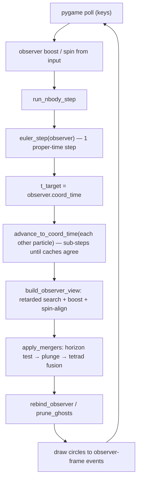
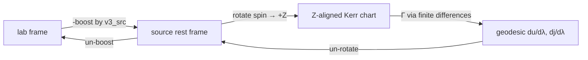

# BlackHoleSky

A real-time relativistic sandbox: an N-body **black hole / particle duality** engine where every
body is a rotating Kerr source, gravity is solved as geodesic motion on a numerically
assembled Kerr–Schild metric, and the camera is itself a physical particle — you see the
universe only through light that has actually had time to reach you.

Rendered with `pygame` at 60 fps, driven by `numpy`/`scipy`. No game engine, no shaders, no
supercomputer: pure-Python numerics with a low-level renderer.

> **Status: playable prototype (`v0.01`).** The window opens, the physics integrates, mergers fire,
> and the geometry self-checks pass at machine precision. Rendering is point sprites on a black
> field — visuals are deliberately second to the simulation right now.

---

## Table of contents

- [What makes it different](#what-makes-it-different)
- [Quick start](#quick-start)
- [Controls](#controls)
- [Scenes](#scenes)
- [What you are looking at](#what-you-are-looking-at)
- [Architecture](#architecture)
- [The physics](#the-physics)
- [Repository layout](#repository-layout)
- [Verifying your install](#verifying-your-install)
- [Tuning the simulation](#tuning-the-simulation)
- [Known limitations](#known-limitations)
- [Contributing](#contributing)
- [References](#references)
- [Author & license](#author--license)

---

## What makes it different

Most "space games" fake gravity with `F = GMm/r²` and treat the camera as an disembodied eye.
Here:

1. **General relativity is integrated numerically, not approximated.** The metric is built
   point-by-point from a Lorentz-covariant Kerr–Schild tetrad,
   `e[μ,a] = δ[μ,a] + (H/2)·L^μ·l_a`, so `g_μν = η_μν + H·L_μ·L_ν` exactly linearizes the
   Einstein field equations in this chart.
2. **You are a particle, not a camera.** The observer carries 4-velocity and 4-spin, is boosted
   and rotated like everything else, and its spin defines the view's roll.
3. **The past light cone is the render path.** Nothing is drawn "as it is now". Every source is
   resolved to its **retarded event** — the point on its worldline whose separation from you is a
   null vector. Look away from a body long enough and it keeps moving only in your cache; look
   back and you see it as it was.
4. **Every particle is a rotating black hole.** Mass and spin are the only invariants; the same
   `mass`/`spin4` pair feeds both the geodesic equation and the horizon-merger test. Quantum
   behaviour enters as a mass-dependent stochastic position kick per integration step.
5. **Mergers are geometric and causal.** Two horizons touch → the pair plunges in isolation until
   the near-singularity regime is reached → they fuse through a two-sided tetrad
   renormalization. The parents survive as **ghosts**, staying on screen until the light from the
   merger reaches you.

The design intent (from the original author's notes in `Main.py`) is to keep a unified-field-theory
vision intact inside an explorable engine: recovering Lorentz-covariant motion, Newtonian gravity,
and spin/mass invariants from one mechanism, while remaining inspectable line-by-line in Python.

---

## Quick start

**Requirements**

| | |
|---|---|
| Python | 3.11+ (developed on 3.11.2) |
| numpy | tested with 2.4.6 |
| scipy | tested with 1.17.1 (`scipy.linalg.expm`) |
| pygame | tested with 2.6.1 (SDL 2.28.4) |
| GPU / GL | not required (software blitting) |

```bash
git clone https://github.com/BlackHoleNerd314/BlackHoleSky.git
cd BlackHoleSky

python -m venv .venv
source .venv/bin/activate          # Windows: .venv\Scripts\activate
pip install numpy scipy pygame

python Main.py
```

`Main.py` runs the geometry self-tests, prints `ScienceEngine running...`, opens a 720×480
window titled **Science Engine v0.01**, and starts the loop. Close the window to exit.

There is no `requirements.txt` / `pyproject.toml` yet — the `pip install` line above *is* the
dependency manifest.

**No display?** (CI, SSH, containers) the loop still runs headless:

```bash
SDL_VIDEODRIVER=dummy SDL_AUDIODRIVER=dummy python Main.py
```

---

## Controls

All input is polled per frame (`pygame.key.get_pressed`), so combinations are live and additive.
Movement is applied **in the observer's body frame**; the 6 DOF are thrust + angular velocity.

| Keys | Action |
|---|---|
| `W` / `S` | boost forward / backward |
| `A` / `D` | boost left / right |
| `Space` / `Shift` | boost up / down |
| `↑` / `↓` | pitch up / down |
| `←` / `→` | yaw left / right |
| `Q` / `E` | roll left / right |
| `T` / `G` | integration step `dλ` × / ÷ `2^(1/12)` |
| `Y` / `H` | thrust strength × / ÷ `2^(1/12)` |
| `U` / `J` | observer mass × / ÷ `2^(1/12)` |
| `M` | **rebase the domain** (see below) |
| window close | quit |

Notes worth knowing before you fly:

- The `×/÷` keys are **per-frame semitone steps**: hold `T` and `dλ` doubles in 12 frames — ~2× per
  octave, smooth enough to feel like a fader rather than a switch. `dlambda` also inversely scales
  how much angular velocity a rotation tap adds, so time scale and handling are coupled.
- Rotation is not a rate-limited look — it injects angular velocity `w_body`, and the observer's
  4-spin is rebuilt from it every frame (`observer.spin = (0, w_world)`), then constrained to
  `j_μ u^μ = 0`. Your own spin is therefore the view's reference orientation.
- Boosting composes as **Lorentz boosts**, so you never exceed `|v| < c`; speeds clamp to
  `1 - 1e-10` in natural units and the 4-velocity is renormalized to `η_μν u^μ u^ν = -1` each frame.
- There is **no `Esc`-to-quit** yet; close the window.

### What `M` (rebase) does

`Domain.RebasedStep` is the one button that makes long sessions survivable. It throws away every
worldline cache, then re-instantiates each particle *from the retarded event you are currently
seeing*, into your instantaneous rest frame, and pins the observer at the origin with
`u = (1,0,0,0)`. The simulation restarts its bookkeeping from what is visually true for you,
instead of dragging an ever-growing history and an accumulating coordinate-time mismatch. Any
particle that is not currently visible to you is dropped from the live set.

---

## Scenes

Scenes are plain factory functions in `InitializeScene.py` returning
`(particles, observer_name, dlambda)`. The renderer loads `run_example()`; swap the call in
`RelativisticRenderer.Start()` to try another.

| Scene | Description |
|---|---|
| `run_example()` | **Default.** Two mass-10 bodies (`p1`, `p2`) at radius 100 with opposed `±x` velocities of `v_c/2` (`v_c = √(M/r0)`), placed 1500 units of `z` away and back-dated to `t = −t_ret0 ≈ −1503` so their light has had time to arrive; observer `p3` sits at the origin drifting at `v_z = −0.1`. `dlambda = 10`. |
| `run_example_debug(n, r)` | `n` bodies on Gaussian-jittered positions of scale `r`, random unit-normal 4-spin, mass `U(0,1)`, all initially at rest; `p0` is the observer, `dlambda = 1`. A good stress test for retarded search, jitter and mergers. |
| `spawn_grid(n, spacing)` | The particle generator behind the debug scene, if you want to compose your own. |

Positions are `(t, x, y, z)` 4-vectors, so note that the default scene's `-t_ret0` initial time is
a *deliberate* backward seeding of the retarded-time window, not a typo.

---

## What you are looking at

One dot per visible source, per frame — but each value encodes real physics:

```python
brightness = min(1.0, delta_lambda * 0.5 / dlambda)   # grey level
radius     = max(1, int(540 * src_mass / dist))       # apparent size
sx, sy     = width/2 ± 540 * Xv/Zv                    # pinhole projection, Zv > 0.1
```

- **Brightness is a time-dilation readout.** `delta_lambda` is how much *the source's own proper
  time* advanced since your last view of it. A source deep in a potential well or receding
  relativistically accumulates less proper time between sightings and therefore dims; a source
  running fast relative to you brightens. It is a crude but physically-fed luminosity proxy,
  not distance falloff.
- **Size is `mass / distance` in the observer frame** — the apparent angular size of a hole tracks
  its mass here, so a merger looks like a *growing* dot, while the two parents stay put as ghosts.
- **Only `Zv > 0.1` draws** — behind-you sources are correctly not rendered, and no source is
  drawn at its simultaneous ("now") position.
- **Ghosts.** Post-merger parents are kept in a separate list and drawn only while the retarded
  time you receive is still earlier than their `death_time` — so a collision visually "happens"
  only when its light arrives, and the pre-merger pair lingers on screen while the merged body is
  already pulling on you.

---

## Architecture



Per-source evaluation chain inside `compute_acceleration` — the same sandwich is reused by the
view builder and by the merger renormalization:



Design rules the code sticks to (and that future changes should preserve):

- **Rotation is applied between the boosts, never to the tetrad** — an active rotation is physical,
  a passive one is a coordinate relabelling that would break the chart the metric was built in.
- **The spin axis is always +Z inside the source rest frame.** Arbitrary orientation is carried by
  the 4-spin vector, and the geometry is evaluated after aligning it.
- **The renderer receives observer-frame data only.** No lab-frame quantity is exposed to drawing
  code; `x4_obs` is already boosted (and `R0` is a display-basis rotation).
- **Caches are the worldline truth.** Retarded positions are a binary search on a cache that is
  guaranteed to span the needed coordinate-time range, which is precisely why all particles are
  synchronized to `t_target` rather than stepped once each.

---

## The physics

**Conventions.** `G = c = 1`. Metric signature `η_μν = diag(−1,1,1,1)`. Index order `(0,1,2,3) = (t,x,y,z)`.
Timelike normalization `η_μν u^μ u^ν = −1`; spin is spacelike `η_μν j^μ j^ν = +1` and
orthogonal to velocity `j_μ u^μ = 0`, imposed at initialization by
`KS.Initialize_spin_vector` and preserved thereafter by parallel transport.

**Geometry.** For a source of mass `m` and Kerr spin parameter `a`:

| Quantity | Expression |
|---|---|
| Kerr radius | `r⁴ − (R²−a²)r² − a²z² = 0` → `KS._ks_r` |
| KS scalar | `H = 2 m r³ / (r⁴ + a² z²)` → `KS._ks_H` |
| Null vector | `L^μ = (1, (rx+ay)/(r²+a²), (ry−ax)/(r²+a²), z/r)` → `KS._ks_L` |
| Tetrad | `e[μ,a] = δ[μ,a] + (H/2) L^μ l_a` |
| Metric | `g_μν = η_ab e_μ^a e_ν^b = η_μν + H L_μ L_ν` |
| Connection | `Γ^μ_αβ` from **centered finite differences** of the metric (`eps = 1e-6`) |
| Motion | `du^μ/dλ = −Γ^μ_αβ u^α u^β`, `dj^μ/dλ = −Γ^μ_αβ j^α u^β` |

The metric is stationary, so only spatial derivatives are nonzero and the time row of `∂_α g_μν`
is left at zero. `L` is null with respect to both `η` and `g`, which is what collapses
`η + H L L` into the standard Kerr–Schild form.

**Lorentz group.** All boosts and rotations come from one matrix exponential,
`Λ = exp(M)`, with `M` built from rapidities `(Kx,Ky,Kz)` and rotation angles `(Jx,Jy,Jz)`
(`Minkowski.lorentz_transform_matrix`). A pure boost is `|v| → artanh` rapidity along the unit
direction; `lorentz_inverse` uses `Λ⁻¹ = η Λᵀ η`; `rotation_to_align_spin` builds the minimal
rotation `n̂ → ẑ` with the two degenerate cases (already aligned → identity; anti-aligned →
`π` about `x̂`) handled explicitly.

**Integration.** Forward Euler in **proper time** `λ`. Each step: apply the stochastic kick,
accumulate `du`, `dj`, advance `pos += u·dλ`, then snapshot to the cache. Since `dt/dλ = u⁰ = γ`,
coordinate time advances at least as fast as proper time — fast bodies need *fewer* sub-steps to
catch up to `t_target`.

**Quantum term.** `BlackHoleOrbiter.Quantum` adds an isotropic Gaussian displacement of scale
`sqrt(dλ/m)` in the particle's rest frame, then boosts it back to the lab. Lighter particles
diffuse more; heavy bodies are classically stiff. This is the "quantum" knob and it is what makes
small masses visibly jitter and prevents perfectly stable artificial orbits.

**Causality.** `retarded_position` bisects on `f(t_ret) = (t_obs − t_ret) − |x_src(t_ret) − x_obs|`
to `tol = 1e-10` (≤ 64 iterations) over the cache interval `[t_min, min(t_max, t_obs)]`; states
between cache entries are linearly interpolated. When no root is bracketed the nearest endpoint is
returned, which is what makes birth/death clamping detectable as `t_ret == cache edge`.

**Mergers.** Trigger: `|x1 − x2| ≤ 2m1 + 2m2`, since `horizon_radius(p)` returns `2 * p.mass` — the
Schwarzschild radius of `p`'s mass. On trigger the pair is integrated in
isolation until either the relative Kerr radius drops below `eps = 1` — where finite-difference
Christoffels stop being trustworthy — or a NaN/γ > 100/explosion guard trips, in which case the
bad cache entries are truncated and the last good state is restored. Fusion then maps `(m·u, m·j)`
of *each* parent through *the other's* tetrad, sums them, adds orbital angular momentum computed in
the pair's center-of-momentum frame, and rebuilds mass, 4-velocity and 4-spin from the result.
Names become `"p1+p2"`, and `parent_ids`/`children` track lineage — which is how a merged body
inherits the camera when the observer is the one that merged away.

---

## Repository layout

Flat, module-level functions, no package. ~1,780 lines total.

| File | Lines | Role |
|---|---:|---|
| `Main.py` | 30 | Entry point: run diagnostics, then `play()`. Carries the project's design notes. |
| `RelativisticRenderer.py` | 211 | pygame loop: `Start` / `Update` / `play`, input, projection, brightness, ghosts. |
| `BlackHoleOrbiter.py` | 291 | The engine. Retarded N-body acceleration, quantum kick, Euler step, coordinate-time sync, observer view, frame step. |
| `ParticleMergers.py` | 303 | Horizon test, plunge, tetrad-renormalized fusion, observer rebinding, ghost pruning. |
| `KerrSchild.py` | 145 | Kerr–Schild scalar/null vector/tetrad/metric, finite-difference `Γ`, geodesic + spin transport. |
| `Minkowski.py` | 150 | Metric, `expm` Lorentz group, boost/rotation constructors, 4-vector normalizations. |
| `Particle.py` | 176 | The `Particle` type: state, worldline cache, interpolation, retarded-position bisection. |
| `Domain.py` | 51 | `RebasedStep` — the cache-clearing observer-centric re-derivation bound to `M`. |
| `InitializeScene.py` | 83 | Scene factories (`run_example`, `run_example_debug`, `spawn_grid`). |
| `UnitTests.py` | 340 | Independent re-derivation of the tetrad/metric/connection/spinor machinery + geometry self-tests, plus the reference bibliography in its header. |

Naming note: the repo is **BlackHoleSky**, the physics core is **BlackHoleOrbiter**, and the window
title is **Science Engine v0.01** — the same engine at three altitudes. Renaming is on the roadmap;
treat these as aliases today.

---

## Verifying your install

The self-tests are **diagnostic prints, not assertions**: each test prints a residual matrix that
should be ≈ 0. A clean run shows entries on the order of `1e-15`–`1e-16` and exact zeros for the
Lorentz-tetrad and metric cross-checks — i.e. agreement at double precision. A `Traceback` means
a dependency or platform problem.

```bash
python -c "import UnitTests as C; C.TestAll()"   # random (m,a,t,x,y,z,K*,J*) per call
```

What each one proves:

| Test | Check |
|---|---|
| `MinkowskiMetricTest` | `g⁻¹` pulled through the tetrad returns flat `η_ab` (tetrad is metric-compatible) |
| `LorentzTetradTest` | `Tetrad(ΛX, Λ) == Tetrad(X, 0) @ Λ` — Lorentz covariance of the construction |
| `KerrMetricTest` | tetrad-contracted metric equals the explicit `η + H L L` form |
| `VolumeTest` | `det e = 1`, `det g = −1` (unimodular tetrad; correct Kerr–Schild volume element), and `det` of each `γ` generator `= 1` |
| `GammaFrameTest` | `{γ^μ, γ^ν}/2 = η^μν I` — the Majorana gamma matrices satisfy the Clifford algebra |

To sanity-check the *simulation* without a display (60 frames of the default scene, printing cache
growth and the observer's normalization drift):

```bash
SDL_VIDEODRIVER=dummy python - <<'PY'
import RelativisticRenderer as G
a = G.Start()
for _ in range(60):
    a = G.Update(*a)
print("60 frames ok, live particles:", len(a[13]))
PY
```

Expected: completes in a couple of seconds (≈ 21 ms/frame for the 3-body scene on Python 3.11.2 /
numpy 2.4.6), `live particles: 3`, no `nan`.

---

## Tuning the simulation

Most numbers you will want live in plain sight:

| Where | Knob | Default |
|---|---|---|
| `RelativisticRenderer.Start` | viewport | `720, 480` |
| `RelativisticRenderer.Update` | focal length (px) | `540` |
| `RelativisticRenderer.Update` | `boost_strength`, `rot_strength` | `0.06`, `0.001` |
| `RelativisticRenderer.Update` | `brightness` response, `size_factor` | `0.5`, `1` |
| `RelativisticRenderer.play` | frame cap | `clock.tick(60)` |
| `InitializeScene.run_example` | `M`, `r0`, lead time `r0*15`, `dlambda` | `10`, `100`, `1500`, `10` |
| `KerrSchild.christoffel_fd` | finite-difference `eps` | `1e-6` |
| `Particle.retarded_position` | `tol`, `max_iter` | `1e-10`, `64` |
| `ParticleMergers.is_singularity` | plunge cutoff `eps` | `1` |
| `ParticleMergers.apply_mergers` | `dlambda_plunge`, `max_plunge_steps` | `1`, `2000` |
| `ParticleMergers.horizon_radius` | merger trigger radius | `2m` |

Performance: `christoffel_fd` is the hot path — one call evaluates the metric **7 times**
(1 + 6 for the centered differences), and each particle pair costs one such evaluation per
integration sub-step. That is `O(pairs × sub-steps × 7)` per frame, which is why the default
scene runs at `dlambda = 10` and why `T` (larger `dλ`) is the fastest way to raise frame rate at
the cost of accuracy. Reducing `max_plunge_steps` or caching `Γ` helps the worst cases.

Accuracy: forward Euler + finite-difference connections is *intentionally* first-order — it keeps
the numerics readable and debuggable. Expect orbital precession/drift at large `dλ`, and prefer
smaller `dλ` (and rebasing with `M`) for precision.

---

## Known limitations

Verified on the current commit, so you don't chase them as setup errors:

- **Merged mass is not conserved yet.** For two mass-10 bodies the fused body came out at
  `15.175`, `10.588`, `86.403` at separations 39, 20, 5 (parents sum to 20). The tetrad
  renormalization suppresses the near-singularity blow-up but does not yet enforce an
  energy-momentum constraint, and the result is plunge-path dependent. This is the main open
  physics bug.
- **`rebind_observer` fallback crashes.** Case 3 (nearest particle) reads `p.pos4`, but the
  attribute is `p.pos` → `AttributeError`. Only reachable when the observer is gone *and* no live
  particle lists it as a parent, so it is easy to miss and easy to fix.
- **`advance_to_coord_time` has no iteration cap.** If a particle's coordinate time stops advancing
  (NaN, or `u⁰` driven below the target by a bad step), the `while` loop will not terminate.
- **`horizon_radius` uses `2m` for every body**, so touching horizons are common at the default
  `M = 10`; spin (Kerr horizon `m + √(m²−a²)`) is not in the trigger.
- **Rendering is placeholder.** Filled circles only: no accretion disk, lensing, horizon shading,
  sprite, HUD, palette, or audio. `size_factor` and the brightness clamp are stubs to be replaced.
- **No packaging, no automated tests, no license file.** `UnitTests.py` prints residuals for a human
  to read; there is no pytest suite, no CI, no pinned manifest.
- **No pause, menu, save/load, mouse look, or UI of any kind.** `M` and the `T/G/Y/H/U/J` faders are
  the whole interface.

Worth doing next, roughly in order of payoff: fix merger 4-momentum conservation → analytical
`Γ` (or cached `Γ`) → adaptive-`λ` / RK integration → real camera HUD + `Esc` → lensed disk
shading → a packaging pass (`pyproject.toml`, console script, `pytest` wrapper around the existing
residual tests).

---

## Contributing

- Keep the invariants: **boost → rotate-to-`+Z` → evaluate → un-rotate → un-boost**, and never
  rotate the tetrad itself. Physics that only makes sense in the Z-aligned chart belongs in
  `KerrSchild.py`; frame changes belong in `Minkowski.py`.
- Keep rendering strictly observer-centric. If you need a lab-frame number on screen, add it to the
  event dict in `build_observer_view` rather than reaching into `Particle` state from the renderer.
- Anything touching worldline state must call `record()` so the retarded search stays sound, and
  re-apply `j_μ u^μ = 0` after re-instantiation (see `Domain.RebasedStep`).
- Run `python -c "import UnitTests as C; C.TestAll()"` and the headless 60-frame snippet above
  before opening a PR; both are the current regression gate.
- Source files currently use CRLF endings. `pyproject`-less, so no enforced formatter — match the
  file you are editing.

---

## References

The derivations the code follows, as cited in the source headers:

- M. Gürses and F. Gürsey, *A Lorentz Covariant Treatment of the Kerr-Schild Geometry* (1975) —
  the coordinate system that linearizes the Einstein field equations — <http://www.fen.bilkent.edu.tr/~gurses/lorentzcovariant.pdf>
- Kerr–Schild geometry and the Cartan/Weyl scalar treatment — <https://arxiv.org/pdf/0706.0622>
- Spin connection for Kerr–Schild tetrads (used for `SpinConnection`, Appendix A1) —
  <https://arxiv.org/pdf/2107.01114>
- Tetrad construction — <https://arxiv.org/pdf/2203.16252>

The `UnitTests.py` header additionally records the intended endgame: Bargmann–Wigner / Majorana
gamma-matrix equations for a Bohmian trajectory guided by a fixed-spin wavefunction on this
geometry (see `DiracStep`, `SpinorConnection`, `PsiInit` — present but experimental; the demo at the
bottom of that file is commented out).

---

## Author & license

Original MATLAB implementation 2009-08-22; Python revision 2012-05-30 — **Erik Jorgensen**.

No `LICENSE` file is present in this repository, so standard copyright terms apply by default and
the code is **not** currently licensed for reuse. Adding one is an open task; until then, treat this
as private.
